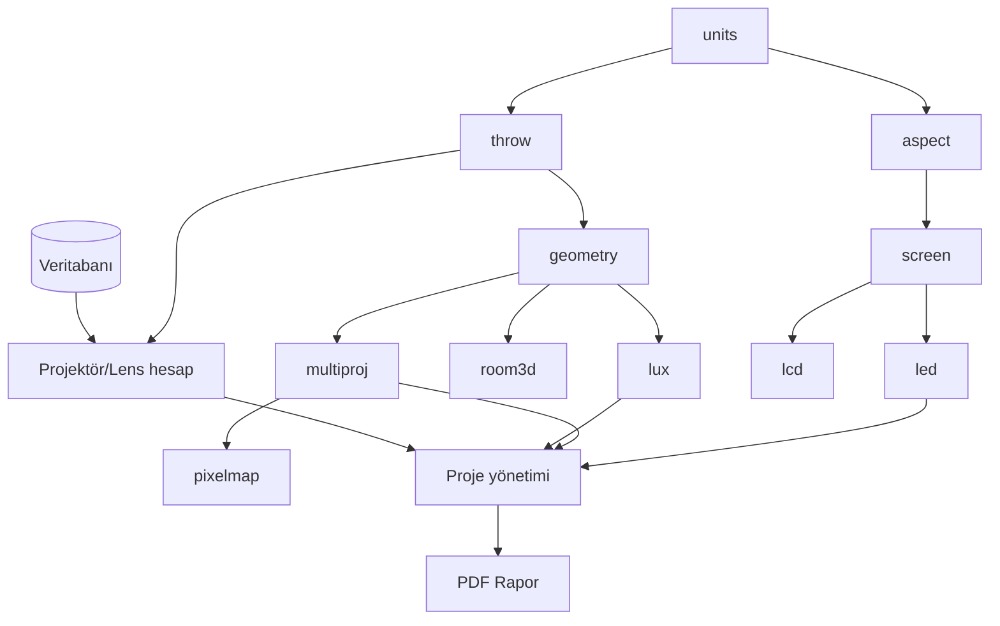

# Projection & Display Design Studio — Mimari

## 1. Mimari değerlendirme
Depo denetlendi: boştu (kod, bağımlılık, veritabanı yok). Mevcut bileşen değiştirilmedi; sıfırdan modüler kurulum yapıldı.

- `frontend/` — React + TS + Vite + Tailwind + Zustand. `src/engine/` **UI'dan bağımsız** saf hesap katmanı (vitest ile test).
- `backend/` — FastAPI + SQLAlchemy 2 + Pydantic. Varsayılan PostgreSQL (Docker), testlerde SQLite.
- `docker-compose.yml` — db + api + web, kalıcı volume, yerel ağ.

Kural: Tüm hesaplar SI birimlerinde (metre) yapılır; birim dönüşümü yalnızca giriş/çıkışta (`engine/units.ts`).

## 2. Veritabanı şeması
| Tablo | Alanlar (özet) |
|---|---|
| manufacturers | id, name (unique) |
| projectors | id, manufacturer_id, model, native_w/h, max_w/h, ansi_lumens, light_source, contrast, aspect, lens_mount, weight_kg, width/height/depth_mm, power_w, inputs/outputs (JSON), orientations (JSON), datasheet_url, notes, **verified** (bool), source |
| lenses | id, manufacturer_id, model, lens_mount, throw_min/max, zoom, h_shift/v_shift (JSON, üretici konvansiyonuyla), shift_convention, focus_min/max_m, dims, datasheet_url, verified |
| projector_lens_compat | projector_id, lens_id, verified, source_note — **açık ilişki**; throw ratio eşleşmesi uyumluluk sayılmaz |
| equipment | id, category, manufacturer, model, specs (JSON), url, image, notes, compat (JSON) |
| customers | id, name, contact |
| projects | id, customer_id, name, location, description, category, project_date, current_revision, archived |
| project_revisions | id, project_id, revision_no, data (JSON: ekipman, hesaplar, geometri, notlar), note, created_at — **değiştirilemez**; üzerine yazma `confirm_overwrite` ister |
| users (Faz 7) | id, username, password_hash, role |

`verified=false` kayıtlar arayüzde "doğrulanmamış / kullanıcı girişi" olarak işaretlenir. Hiçbir üretici verisi seed edilmedi.

## 3. Modül bağımlılık haritası

## 4. Yol haritası
| Faz | Kapsam | Durum |
|---|---|---|
| 1 | Mimari, DB şeması, projektör/lens DB, ekran hesaplayıcı, throw geometri motoru, proje yönetimi | **Uygulandı** |
| 2 | Projektör/lens UI, lux, 2D diyagram | Planlı |
| 3 | Multi-projektör, pixel mapping | Planlı |
| 4 | LED, LCD, ekipman DB UI | Planlı |
| 5 | 3D oda | Planlı |
| 6 | PDF/PNG/SVG, sunum, revizyon UI | Planlı |
| 7 | Entegrasyon, güvenlik (auth/RBAC), yedek, performans | Planlı |

## 5. Formüller (Faz 1)
- Throw ratio TR = D / W; D = W·TR; W = D/TR (D: lensten yüzeye mesafe).
- Şasi–duvar mesafesi = D + lens_offset_derinlik (lens ön yüzü şasiden ne kadar öndeyse çıkarılır/eklenir).
- Yükseklik H = W·(oranH/oranW); diagonal = √(W²+H²).
- Boyutlu ekran: diagonal d → W = d·a/√(a²+b²).
